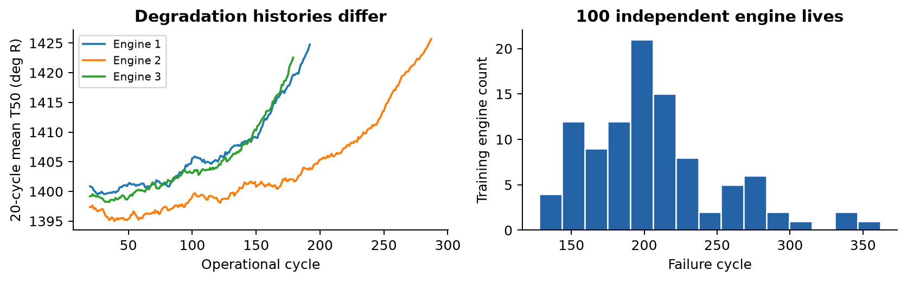
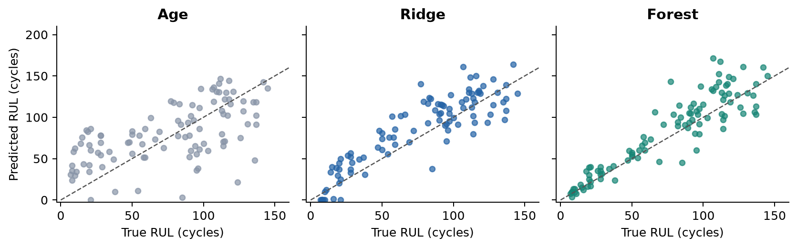
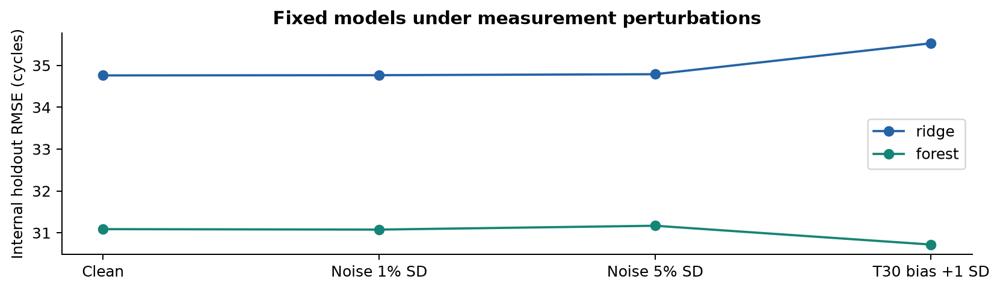

Turbofan remaining useful life from causal sensor histories

**Chua Shanwei** &nbsp; 35393343 MMA3001: Numerical Methods and Machine Learning NASA C-MAPSS FD001

Technical report - nine main pages followed by references. Prepared with substantial AI assistance, disclosed in Section 7. Student review and personal reflection remain necessary before submission.

1. Engineering Problem

A turbofan maintenance planner needs to estimate how many operational cycles remain before a degradation threshold is reached. Scheduling too late risks operating a degraded engine, while scheduling too early wastes useful life. This project estimates a continuous remaining useful life (RUL) from observed age and six temperature, pressure and speed channels. It evaluates whether nonlinear regression provides a defensible benefit over simpler alternatives.

NASA C-MAPSS simulates run-to-failure engine degradation [1,2]. FD001 contains one operating condition and one HPC degradation mode. The 100 training engines provide complete histories; 100 separate test histories stop before failure. A maintenance review would receive an RUL point estimate and input-support warnings, rather than an automatic retirement instruction. A cycle is the benchmark time unit and is not converted into hours or flights.

Figure 1. Training-only evidence: different temperature histories and failure ages motivate sensor-based estimation rather than age alone.

**Scope.** Only FD001 is supported. The model assumes future degradation resembles this simulated population. Other operating conditions, failure modes, maintenance interventions and real fleet deployment are outside the validated scope. Sensor correlations are physically plausible indicators of gas-path degradation, but the regressor does not solve conservation equations or identify a unique wear mechanism.

**Main result.** The predeclared selection rule chose forest. On 100 official endpoints it obtained MAE 14.69 and RMSE 20.04 cycles. These are measured benchmark errors, not a certified maintenance margin.

---

2. Inputs & Outputs

The parser accepts a headerless, whitespace-delimited TXT file with exactly 26 numeric columns: engine ID, cycle, three settings and sensors s1-s21. It sorts by engine and cycle. For prediction, supply one engine with at least 30 contiguous observed rows and retain its absolute cycle numbers. A trailing history may start after cycle 1. Table 1 specifies all primary predictors and outputs; the other source fields are parsed for schema checks.

| Input / symbol | Physical meaning | Unit | Training range / domain |

| --- | --- | --- | --- |

| ID | Engine identifier (excluded from predictors) | none | Positive integer |

| t | Observed operational age | cycles | Positive integer |

| s2 / T24 | LPC outlet total temperature | deg R | 641.21-644.53 |

| s3 / T30 | HPC outlet total temperature | deg R | 1571.04-1616.91 |

| s4 / T50 | LPT outlet total temperature | deg R | 1382.25-1441.49 |

| s7 / P30 | HPC outlet total pressure | psia | 549.85-556.06 |

| s9 / Nc | Physical core speed | rpm | 9021.73-9244.59 |

| s11 / Ps30 | HPC outlet static pressure | psia | 46.85-48.53 |

| setting_1..3 | Operating metadata, excluded | Undeclared | Finite; FD001 only |

| Other 15 sensors | Unused source measurements | Native units | Finite, excluded from model |

Table 1. Native sensor units follow the source paper [2]. Numerical training extrema describe empirical support, not physical validity boundaries. Source settings lack an explicit unit declaration in the supplied README, so no interpretation is invented.

| Output field | Meaning and operational use |

| --- | --- |

| predicted_rul_cycles | max(0, raw prediction), a nonnegative estimate for maintenance review |

| raw_rul_prediction | Unconstrained finite estimate, retained to expose clipping |

| engine_id, cycle | Endpoint identity and observed age for traceability |

| input_status, flags | Empirical sensor-envelope excursions and negative-output clipping |

| model_version | Configuration fingerprint linking the estimate to experimental settings |

**Invalid inputs.** Missing/nonfinite measurements, wrong column count, nonnumeric fields, duplicate engine-cycle pairs, cycle gaps, nonpositive primary sensors and insufficient history raise an explicit error. No imputation or silent row deletion is used. Soft range warnings retain valid but unfamiliar measurements. Unsupported subsets are rejected when declared; the caller remains responsible for declaring the correct regime.

**Provenance.** FD001 has 20,631 training rows and 13,096 test rows. SHA-256 hashes freeze the supplied files. The NASA catalog permits public access but leaves the specific license unspecified [1]. Raw data stay outside public Git history; instructions and a checksum manifest make acquisition auditable.

---

3. Computational Solution

The workflow validates input, forms causal features, partitions engines, tunes models, freezes selection, refits on all training engines, and evaluates official endpoints. It records each step as inspectable CSV/JSON evidence. Model bundles support repeated prediction from the same validated input contract.

3.1 Target and features

For training engine i with verified failure cycle T_i, the target is RUL(i,t) = T_i - t. Failure is zero remaining cycles. The target is uncapped, preserving its engineering meaning. Official test histories are censored: their separate RUL file supplies truth at the last observed cycle. Using the final test cycle as failure would create incorrect zero labels.

At cycle t, each selected sensor contributes its current value, trailing mean and least-squares slope over W observed samples. Together with age, this gives 19 features. Candidate W values are 10, 20 and 30 cycles, but every comparison starts at cycle 30. No observation after t enters its feature vector.

| Quantity | Definition |

| --- | --- |

| Trailing mean | mean_s(t) = sum from j=0 to W-1 of s(t-W+1+j) / W |

| Centered positions | q_j = j - (W-1)/2 |

| Trailing slope | slope_s(t) = sum(q_j s(t-W+1+j)) / sum(q_j squared) |

| Feature vector | x(t) = [age, 6 current values, 6 means, 6 slopes] |

Centered positions reduce cancellation relative to fitting against large absolute cycle numbers. Mean units equal sensor units; slopes use sensor-unit/cycle. Training uses every fifth supported window plus each engine endpoint. Inverse engine-window counts, normalized to mean one, give each engine equal total fitting weight. Both sensor models use this identical sampling rule.

3.2 Random forest and numerical implementation

The proposed nonlinear method averages 200 bootstrapped regression trees [4]. Each tree selects feature thresholds that reduce weighted squared error. Depth (8 or 12), minimum leaf size (5 or 10) and feature fraction (0.7 or 1.0) limit complexity. The forest captures nonlinear age/sensor interactions without requiring a large neural-network training pipeline. Seed 3001 and one computation thread control randomization and timing.

A tree returns a weighted mean of observed training targets in its leaf. The forest therefore interpolates among learned responses and cannot reliably extrapolate to unseen life ranges. More trees reduce Monte Carlo variability but do not remove model bias. Tree stopping constraints are the relevant termination conditions; there is no iterative numerical residual to converge.

The implementation separates parsing, feature construction, fitting, metrics and command-line orchestration in src/jet_rul. NumPy vectorization replaces a reference loop for the same feature formulas. Public functions contain docstrings and generate browsable pdoc HTML. The methods and data contracts are also documented in docs/METHOD.md.

---

4. Alternative Solutions

A sensor-ridge model is a credible linear alternative [3]. Its pipeline standardizes predictors using only fitting-engine rows, then solves a weighted penalized least-squares problem. The direct SVD solver handles correlated sensor/current/mean features more stably than explicitly inverting normal equations. The scaler is unweighted; the regression uses equal-engine weights.

**Objective:** minimize sum_j w_j(y_j - b - z_j^T beta)^2 + alpha ||beta||^2. The intercept b is unpenalized. Alpha candidates are 0.1, 1, 10 and 100. A separate age-only ridge baseline measures how much predictive information exists without any sensor channel.

| Model | Selected CV settings | CV RMSE | Holdout RMSE | Holdout score |

| --- | --- | --- | --- | --- |

| age | W=30, alpha=100 | 39.14 | 42.62 | 3095.8 |

| ridge | W=30, alpha=100 | 29.09 | 34.76 | 867.5 |

| forest | W=30, depth=8, leaf=10, fraction=0.7 | 28.82 | 31.09 | 764.7 |

Table 2. Errors are in cycles. Cross-validation pools 80 independent engine endpoints; holdout results use 20 different engines. NASA score is dimensionless and sample-count dependent. All models use the same eligible endpoints.

**Frozen decision.** The forest had to reduce internal holdout RMSE by at least 5% relative to ridge without increasing NASA score. Its measured relative RMSE improvement was 10.57%. The rule selected **forest**. This decision preceded official test evaluation, so a later test ranking cannot change it.

| Criterion | Age-only | Sensor ridge | Random forest |

| --- | --- | --- | --- |

| Engineering information | Age only | Linear sensor/age effects | Nonlinear interactions |

| Interpretability | Simple age trend | Coefficient signs require care with collinearity | Many local decision rules |

| Extrapolation | Linear and possibly negative | Linear and possibly negative | Bounded by learned leaf responses |

| Numerical handling | Scaling + SVD + penalty | Scaling + SVD + penalty | Depth/leaf bounds + ensemble averaging |

| Implementation burden | Lowest | Low | Higher fitting/storage cost |

Deep recurrent models and capped-RUL training are plausible future alternatives, but each would add tuning decisions or change the target. They are excluded to preserve a tractable, interpretable study. Published leaderboard scores are not claimed as directly comparable because capping, sensor selection and endpoint conventions often differ. The implemented alternatives provide a controlled local benchmark.

---

5. Validation

5.1 Engine separation and verification

The 100 training engines are split into 80 development and 20 internal holdout engines. Five-fold cross-validation on the 80 development engines uses 64 fitting and 16 validation engines per fold. Each validation engine contributes one saved pseudo-endpoint chosen uniformly from cycle 30 through T_i-1. Its features use only observations available at that time. Fixed IDs and endpoint cycles are recorded in splits.json.

The search contains 12 ridge and 24 forest configurations, plus four age-only alternatives. Validation RMSE pools all 80 endpoint errors. The internal holdout chooses between the CV winners, so it is a selection set. After that choice is saved, all models refit using all 100 complete training engines. The official evaluation then uses one endpoint from every one of the 100 separate test engines. No difficult engine is excluded.

The preliminary data audit inspected source dimensions and test-label summaries. Model-selection code never parses official test observations or labels; it only verifies their file hashes. A synthetic integration test deliberately supplies nonnumeric test files and still completes model selection. Configuration changes after selection cause final evaluation to refuse execution.

| Verification group | Evidence / expected property |

| --- | --- |

| Source and labels | 26 columns, finite numbers, correct domains, no gaps/duplicates, known RUL sequence [3,2,1,0] |

| Causal features | Analytic constant/linear signals, independent engine histories, future-data mutation invariance |

| Numerical comparison | Vectorized and loop features agree to floating-point tolerance; collinear ridge fit remains finite |

| Validation boundary | Disjoint/reproducible engine IDs, fit-only scaler, official-target parsing prevented |

| Outputs and metrics | Known MAE/RMSE/bias, late penalty > early penalty, explicit overflow, persistence and clipping |

| Execution | 37 pytest checks passed; machine-readable JUnit report and CI workflow supplied |

5.2 Metrics and acceptance criteria

For error e = predicted RUL - true RUL, MAE = mean(|e|), RMSE = sqrt(mean(e^2)) and bias = mean(e). Positive errors overestimate life. The NASA-style score sums exp(-e/13)-1 for e&lt;0 and exp(e/10)-1 otherwise. It penalizes late predictions more strongly: an error of +10 cycles scores 1.718, versus 1.158 for -10. The implementation uses expm1 for accuracy near zero.

The supplied local paper prints constants inconsistent with its prose; the NASA NTRS version supports the explicit early=13, late=10 convention [2]. Stating and testing the formula avoids ambiguity. MAE &lt;=20 and RMSE &lt;=25 cycles were proposed engineering targets, not regulatory acceptance limits. Physical plausibility, support warnings and error bands remain relevant even when an average target is met.

Paired bootstrap resampling uses 2,000 samples of the 100 engine endpoints. Its percentile intervals quantify metric uncertainty conditional on these fitted models. They are not individual-engine prediction bounds and exclude uncertainty from collecting another training fleet.

---

5. Validation - official results

| Model | MAE | RMSE | Bias | NASA score | Clipped |

| --- | --- | --- | --- | --- | --- |

| age | 28.83 | 34.89 | 4.09 | 8770.3 | 1 |

| ridge | 18.26 | 22.29 | 9.29 | 1670.4 | 6 |

| forest | 14.69 | 20.04 | 7.09 | 2174.6 | 0 |

Table 3. Official FD001 test endpoints (n=100). MAE/RMSE/bias are in cycles. Metrics use nonnegative output predictions; raw-prediction metrics are also saved. Lower error and score are better. Positive bias means optimistic lifespan estimates.

Figure 2. Each dot represents a different official test engine. The dashed line is perfect endpoint prediction. No test outcomes were used to select model settings.

The selected forest model has MAE 14.69 cycles with bootstrap 95% interval [12.11, 17.49], and RMSE 20.04 cycles with interval [16.33, 23.56]. The paired forest-minus-ridge RMSE difference interval is [-4.87, 0.29] cycles. An interval spanning zero does not establish a consistent advantage for either model on this test population.

The selected model meets the MAE target of 20 cycles and meets the RMSE target of 25 cycles. Relative to age-only, its test RMSE changes by 42.5%. The result demonstrates the value and limits of sensor information; it does not justify treating an individual forecast as a guaranteed safe life.

**Safety-sensitive tradeoff.** Forest test NASA score is 2174.6, worse than ridge's 1670.4, despite lower MAE and RMSE. The holdout score advantage did not generalize. The selected forest is retained to avoid test-driven reselection, but its optimistic tail errors weaken any maintenance-use claim.

| True-RUL band | Engines | MAE | RMSE | Bias |

| --- | --- | --- | --- | --- |

| <=30 | 25 | 5.75 | 7.95 | 4.03 |

| 31-80 | 20 | 13.96 | 20.71 | 9.98 |

| >80 | 55 | 19.02 | 23.36 | 7.42 |

Table 4. Selected-model performance by actual remaining life. This retrospective stratification reveals where errors occur; true RUL is unavailable during normal inference and is never a predictor.

---

5. Validation - robustness and limitations

Figure 3. Fixed models on 20 internal holdout engines. Noise amplitudes are percentages of development sensor SD. A +1 SD T30 bias represents an illustrative calibration error, not a documented sensor specification.

Short zero-mean perturbations and systematic bias test different failure mechanisms. Averaging reduces some measurement noise, while a persistent bias shifts the whole feature history. These studies characterize already frozen models and do not retune them. The small internal holdout limits the precision of sensitivity conclusions.

| Engine | True RUL | Predicted RUL | Signed error |

| --- | --- | --- | --- |

| 67 | 77 | 143.10 | +66.10 |

| 78 | 107 | 171.53 | +64.53 |

| 1 | 112 | 167.48 | +55.48 |

Table 5. Three largest absolute endpoint errors for the selected model, in cycles. These are disclosed failure examples, not discarded outliers.

The input-support audit flags 0 of 100 test engines for sensor-envelope excursions and/or clipping. A warning marks limited support, not proof of a failed sensor. All flagged engines remain in the metrics. The system returns a point estimate without calibrated predictive uncertainty.

**Limits of engineering credibility.** FD001 is a simulated, restricted regime. Initial condition and wear variation can yield similar measured histories with different remaining lives. A point regressor cannot uniquely recover latent damage. Long-horizon uncertainty, nonmonotone successive forecasts, unmodeled fault modes and operation outside the training envelope are expected failure modes. No monotonicity or conservation constraint is imposed, and the available selected channels do not establish a full thermodynamic balance.

The internal pseudo-endpoint distribution differs from the official censoring process. Bootstrap intervals assume the test engines are representative independent units. The single fixed train/holdout split and small fleet limit generality. The NASA score can be dominated by a few optimistic errors, so it accompanies MAE, RMSE, bias and case-level evidence.

**Next experiment.** A separate future study should compare uncertainty-calibrated estimates and regime-aware features on a newly reserved validation set. Any adaptation after inspecting this test set requires new untouched evaluation data. Real deployment would additionally require field measurements, sensor calibration and an approved maintenance decision process.

---

6. Optimization & Performance

Measurements use Python 3.12.14 on Windows-11-10.0.26300-SP0, one thread and warm in-memory models. Prediction times exclude file/model loading. Thirty repetitions report median and interquartile range (IQR); three repetitions measure refitting. The machine processor identifier is Intel64 Family 6 Model 126 Stepping 5, GenuineIntel. Timings are hardware-dependent.

| Model | Fit (s) | Model only (ms), IQR | History + model (ms) | File (KiB) |

| --- | --- | --- | --- | --- |

| age | 0.0032 | 0.243
[0.240,0.295] | 6.73 | 0.9 |

| ridge | 0.0077 | 0.314
[0.260,0.410] | 7.91 | 1.5 |

| forest | 3.0188 | 14.235
[13.703,15.004] | 20.29 | 1100.1 |

Table 6. One-engine prediction; history timing includes validation, trailing features and warnings. Batch-100 timings and all individual fit timings are saved in performance.json.

**Vectorization.** The explicit feature loop takes 0.2914 s versus 0.1831 s for the vectorized version on 20,631 rows: 1.59x speedup. Their maximum absolute element difference is 1.88e-13. This preserves the formula and predictions within numerical tolerance. cProfile records the remaining cumulative-time costs.

| Stride | Feature set | Fit windows | RMSE (cycles) | Fit (s) |

| --- | --- | --- | --- | --- |

| 1 | 7 current only | 11370 | 27.48 | 4.828 |

| 1 | 19 with trends | 11370 | 31.09 | 12.247 |

| 5 | 7 current only | 2347 | 27.83 | 0.856 |

| 5 | 19 with trends | 2347 | 29.30 | 2.406 |

Table 7. Fixed-parameter forest ablation on the first 64/16-engine development fold. Changing sampling or feature count trades computation against accuracy. This diagnostic does not override frozen selection.

At stride 5, current-only features improve this fold RMSE from 29.30 to 27.83 cycles. Thus trends are not uniformly beneficial. Stride 5 reduces full-feature fit time from 12.25 to 2.41 s here. The small diagnostic fold motivates a future feature study, not a post-test change to the reported model.

**Arithmetic and memory.** Ridge uses d=19: approximately 38 FLOPs for its dot product/intercept plus 38 for separate scaling. A hypothetical fused cold calculation reads about 320 bytes, or 0.119 FLOP/byte. This excludes Python, input checking and cache effects; sklearn is not claimed to implement that fused kernel. Forest endpoints average 1502.8 threshold comparisons and 200 aggregation FLOPs. Comparisons are not counted as FLOPs.

The forest contains 46,108 nodes and 3.32 MB of node/value arrays. A no-cache-reuse traversal estimate is 106.4 KiB per endpoint. Process current RSS is 183.3 MB and reported peak is 188.7 MB (Windows process lifetime peak working set); these include the interpreter, libraries and data, rather than isolated model memory.

Feature construction is O(N*6*W); balanced-tree fitting is approximately O(B*m*N*log N), and prediction O(B*depth). Low arithmetic intensity and irregular tree access explain why FLOPs alone predict runtime poorly. Tree counts 50-400 and three seeds are recorded. Across seeds 3001-3003 the development-fold forest RMSE ranges 29.30-31.32 cycles. Further optimization should target measured overhead, without sacrificing validation or expanding test-driven tuning.

---

7. AI Use & Reflection

**Tool and extent.** OpenAI Codex provided substantial assistance across experiment design, Python implementation, pytest tests, documentation, report writing, figures, presentation materials and repository preparation. Most code and prose in this prepared version were AI-generated. The student selected the jet-engine lifespan topic, supplied the NASA files and assessment brief, and specified the submission identity and GitHub repository. This is not presented as independently student-written work.

**Purpose and checking.** AI assistance accelerated implementation and helped connect numerical analysis, machine learning and software reproducibility. Generated work was checked with analytic constant/linear signals, engine-separation and future-leakage tests, parser boundary cases, known metric values, independent official endpoint evaluation and measured profiling. Reported numbers are read from saved experiment artifacts. Those automated checks support correctness, but do not establish student understanding.

**Concrete corrections.** The first invalid-value tests attempted to insert infinity or a fractional ID into integer-typed pandas fixtures. Pandas rejected the test setup before the project validator ran. Explicitly floating-point corrupt fixtures fixed the test itself. The supplied paper also contained contradictory scoring constants; the project retained an explicit formula supported by the NASA NTRS version and tested that optimistic errors receive the larger penalty. These cases show why plausible generated code or formulas require evidence.

**Technical lessons supported by the evidence.** Engine-level validation addresses dependence that a random row split would hide. The censored test endpoint requires an external RUL label. Linear regression with regularization is a serious alternative when data are limited and features are strongly related. A forest adds computational cost and must justify that cost quantitatively. A measured model-selection result takes precedence over an initial preference for a more complex method.

**Student responsibility.** The student must personally verify the source, understand the mathematics and code, judge whether the scope meets teaching-team expectations, and accept responsibility for the submitted claims. This generated report cannot demonstrate individual learning or oral-defense competence on its own. The remaining personal reflection must describe what the student actually learned, checked and changed after running and reviewing the project. No first-person learning experience is fabricated here.

| Before assessment | Student-owned evidence to add |

| --- | --- |

| Reproduce | Record a personal run, environment and comparison with the supplied metrics |

| Explain | Derive one trailing slope and one ridge/forest prediction mechanism without AI |

| Critique | Choose an actual large-error engine and discuss what the model cannot infer |

| Reflect | Add genuine examples of an AI suggestion accepted, corrected or rejected |

| Rehearse | Deliver the 5-minute talk and answer the 3-minute defense without AI assistance |

The repository includes docs/AI_USE.md with an assistance log and reflection prompts, and presentation/DEFENSE.md with technical practice questions. Commit history records genuine implementation stages rather than fabricated semester-long activity. Neither disclosure nor automated tests replace the individual learning requirement.

---

References

References are outside the nine-page main report.

[1] NASA, C-MAPSS Jet Engine Simulated Data, official catalog.

<link href="https://data.nasa.gov/dataset/cmapss-jet-engine-simulated-data" color="#2463a6">https://data.nasa.gov/dataset/cmapss-jet-engine-simulated-data</link>

[2] A. Saxena, K. Goebel, D. Simon and N. Eklund, Damage Propagation Modeling for Aircraft Engine Run-to-Failure Simulation, 2008 International Conference on Prognostics and Health Management. NASA NTRS record 20090029214.

<link href="https://ntrs.nasa.gov/citations/20090029214" color="#2463a6">https://ntrs.nasa.gov/citations/20090029214</link>

[3] Scikit-learn documentation, Ridge regression and SVD solver.

<link href="https://scikit-learn.org/stable/modules/generated/sklearn.linear_model.Ridge.html" color="#2463a6">https://scikit-learn.org/stable/modules/generated/sklearn.linear_model.Ridge.html</link>

[4] Scikit-learn documentation, RandomForestRegressor.

<link href="https://scikit-learn.org/stable/modules/generated/sklearn.ensemble.RandomForestRegressor.html" color="#2463a6">https://scikit-learn.org/stable/modules/generated/sklearn.ensemble.RandomForestRegressor.html</link>

[5] Scikit-learn documentation, Common pitfalls and recommended practices: data leakage.

<link href="https://scikit-learn.org/stable/common_pitfalls.html" color="#2463a6">https://scikit-learn.org/stable/common_pitfalls.html</link>

[6] pdoc documentation, HTML API documentation generation.

<link href="https://pdoc.dev/docs/pdoc.html" color="#2463a6">https://pdoc.dev/docs/pdoc.html</link>

[7] pytest documentation, test reporting.

<link href="https://pytest.org/en/stable/how-to/output.html" color="#2463a6">https://pytest.org/en/stable/how-to/output.html</link>

[8] MMA3001_2026_Project_Brief.pdf and MMA3001_Project_Brief_Student_Key_Points.pdf, supplied unit assessment documents, 2026. These define report, repository, oral presentation and reflection requirements.

Source checks and preparation: October 2026. Source files remain attributable to their respective owners. Public accessibility is not treated as an explicit data redistribution license.

Reproducibility evidence

Repository: https://github.com/Shanwei0111/MMA3001Project. The README provides environment setup and end-to-end commands. artifacts/ contains saved partitions, configuration, cross-validation records, frozen selection, official predictions, bootstrap intervals, robustness results, profiling and the JUnit test report. docs/html/ contains generated code documentation. scripts/build_report.py regenerates this report from the evidence.

Configuration SHA-256: d550355c50185f8df90462531d2b3dd62642827688f8e8ca097d288098bbb8e7