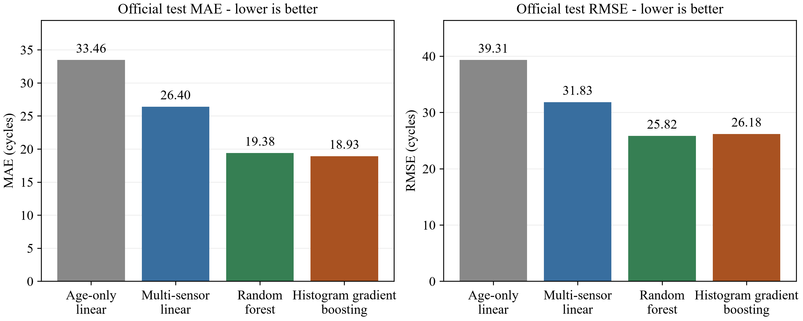
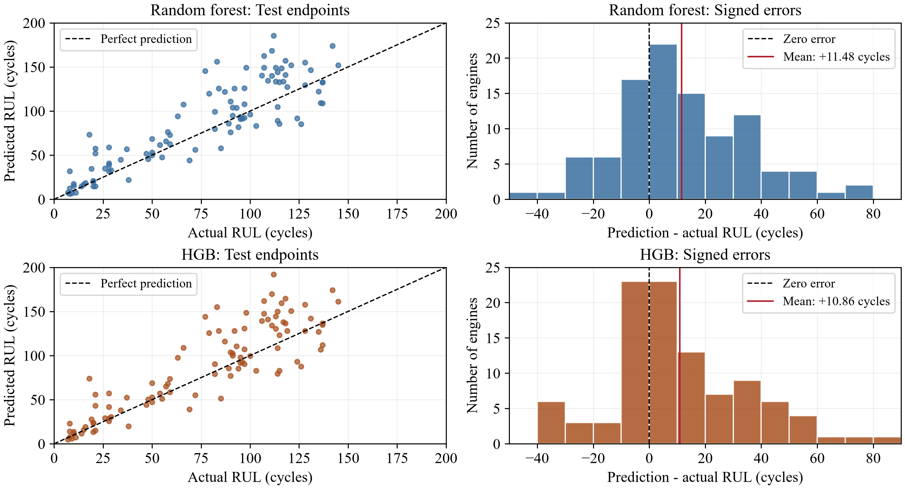

# Turbofan Remaining Useful Life Prediction Using NASA C MAPSS FD001

MMA3001 Numerical Methods and Machine Learning

Chua Shanwei  |  Student ID 35393343  |  25 October 2026

Written Project Documentation  |  Main report pages 1 to 10

### Summary

Remaining useful life (RUL) was estimated for simulated turbofan engines using operating age and six gas-path sensor measurements from NASA C-MAPSS FD001. Four regression models were evaluated. Random forest achieved an official test endpoint RMSE of 25.82 cycles and an asymmetric score of 5804.70, supporting its selection as the primary model. Histogram gradient boosting (HGB) produced the lowest MAE, 18.93 cycles, while training approximately 18.1 times faster and using 89.5% less serialized storage. Both ensembles overestimated RUL on average. Their accuracy and computational requirements are examined alongside the linear baselines.

## 1 Engineering Problem

Turbofan degradation affects compressor and turbine temperatures, pressures and rotational speeds. Engines with the same operating age can therefore have different remaining lives. An age-only prediction captures a fleet-level trend but cannot account for differences in initial wear or subsequent deterioration. This project investigates whether condition measurements improve RUL estimation and whether the improvement justifies the additional computational cost.

The intended application is maintenance planning for a simulated engine fleet. RUL estimates could help identify engines requiring earlier inspection: an overestimate may delay intervention, whereas an underestimate may lead to premature maintenance. Prediction error is therefore assessed in both magnitude and direction.

### Scope and physical assumptions

FD001 contains one sea-level operating condition and one high-pressure-compressor degradation mode, with 100 complete training histories and 100 censored test histories (National Aeronautics and Space Administration [NASA], n.d.; Saxena et al., 2008). The engines are treated as exchangeable units of the same simulated type. Each training history ends at the simulated failure threshold; test observations stop earlier. The cycle count represents operating repetitions and requires additional information before it can be converted into flight hours.

The study is restricted to FD001 predictions from the current sensor snapshot and cycle count. Gas-path conservation equations and hidden damage states are not modelled. Other operating regimes, fault modes, real-flight validation and calibrated per-engine uncertainty are outside scope; no maintenance threshold, economic cost model, guaranteed safe interval or autonomous scheduling policy is derived. Within this scope, the models are compared through the implementation, validation and performance analysis required by the unit briefs (*MMA3001: Numerical Methods and Machine Learning Project Brief*, 2026; *MMA3001: Project Brief Student Key Points*, n.d.).

<!-- Page break -->

## 2 Inputs and Outputs

The input files are train_FD001.txt (20,631 rows), test_FD001.txt (13,096 rows) and RUL_FD001.txt (100 endpoint labels). Each history is stored as whitespace-delimited numeric text without a header. The parser checks for 26 columns: engine ID, cycle, three settings and 21 sensors. Training lifetimes range from 128-362 cycles, with a mean of 206.31. Official RUL labels correspond to the final test records in engine-ID order.

| Field | Physical meaning | Unit | Observed training range |
|---|---|---|---|
| engine_id | Grouping key; excluded from predictors | Integer ID | 1 to 100 |
| cycle, t | Accumulated operating cycles | cycles | 1 to 362 |
| sensor_2, T24 | LPC outlet total temperature | degrees R | 641.21 to 644.53 |
| sensor_3, T30 | HPC outlet total temperature | degrees R | 1571.04 to 1616.91 |
| sensor_4, T50 | LPT outlet total temperature | degrees R | 1382.25 to 1441.49 |
| sensor_7, P30 | HPC outlet total pressure | psia | 549.85 to 556.06 |
| sensor_9, Nc | Physical core speed | rpm | 9021.73 to 9244.59 |
| sensor_11, Ps30 | HPC outlet static pressure | psia | 46.85 to 48.53 |

Table 1. Predictor and key specification. Sensor definitions follow Saxena et al. (2008, Table 2). R denotes Rankine, not Celsius. Ranges describe this training sample, not certified operating limits.

The age-only model uses cycle count. The remaining models use cycle and the six sensors in Table 1, in a fixed order. Engine IDs are reserved for grouping and alignment. Unused settings and sensors are retained in the source data, with no assumed conversion of settings' units. The sensor subset was selected on engineering grounds rather than through an exhaustive search.

### Targets and outputs

$$
y_{it}=T_i-t,\qquad T_i=\max_{t\in\mathcal{T}_i}t
$$

$$
\widehat{y}_{it}=\max\!\left(0,f(\mathbf{x}_{it})\right)
$$

Here, T_i is the final recorded cycle of training engine i; its observed cycles form the set shown in the first equation.

Training targets are uncapped and span 0-361 cycles; official test labels span 7-145. The workflow produces raw and clipped predictions, signed errors, metric CSVs, figures, timing results and pytest XML. Metrics are calculated before rounding. A clipped zero represents the lower bound imposed on the estimate.

### Invalid and unsupported inputs

Label construction rejects empty data, missing keys, nonfinite/nonpositive/noninteger IDs or cycles, and duplicate engine-cycle pairs. Metric evaluation rejects incompatible shapes, empty/nonfinite arrays and negative true RUL. Test ingestion checks the label count and consecutive sorted IDs. Imputation, comprehensive sensor-range checks and unit conversion are not implemented. Although HGB can internally handle missing features, this capability is not implemented consistently across the workflow; missing sensors, alternative units and other operating regimes are unsupported.

### Shared function inputs and outputs

In rul_utils.py, add_training_rul(data) returns a copy with RUL; split_by_engine(data, n_train=80, random_state=42) returns two disjoint engine-grouped tables. evaluate_rul(actual, predicted) accepts aligned finite one-dimensional arrays and returns MAE, RMSE, bias, overprediction percentage and score; it does not clip predictions. Invalid inputs raise ValueError; score overflow raises FloatingPointError. make_hist_gradient_boosting() takes no arguments and returns an unfitted model with Table 2 settings.

<!-- Page break -->

## 3 Computational Solution

### Workflow and labels

Complete training histories were parsed and labelled before splitting by engine. Linear baselines and nonlinear models were then fitted and compared using held-out validation and grouped cross-validation. The fixed configurations were refitted on all 100 training engines, evaluated at the official test endpoints and profiled. Failure cycles were used only to calculate targets. Smoothing, scaling, time windows, RUL capping and per-engine weighting were omitted, so longer histories contribute more training rows.

### Linear regression and random forest

$$
\boldsymbol{\beta}^{*}=\underset{\boldsymbol{\beta}}{\operatorname{arg\,min}}\;\sum_{j=1}^{n}\left(y_j-\beta_0-\sum_{k=1}^{d}\beta_k x_{jk}\right)^2
$$

$$
f_{\mathrm{RF}}(\mathbf{x})=\frac{1}{B}\sum_{b=1}^{B}h_b(\mathbf{x})
$$

Ordinary least squares was used to establish an interpretable baseline (scikit-learn developers, n.d.-b). The age-only model fits a common relationship between cycle count and RUL. Adding sensors allows the linear model to account for measured condition at a given age. Fitting uses the library's dense least-squares solver instead of explicitly inverting the normal equations. Each coefficient describes a conditional association in its feature's units; coefficients should not be interpreted as causal effects or compared directly as importance scores.

For the age-only development fit on 80 engines:

$$
\widehat{y}_{\mathrm{raw}}=186.3816-0.7405t
$$

Random forest averages the leaf predictions of regression trees fitted to bootstrap samples (scikit-learn developers, n.d.-c). Successive threshold splits capture nonlinear relationships and sensor interactions. Tree depth and minimum leaf size control complexity. Because the training targets are nonnegative, the averaged leaf means are also nonnegative. Predictions remain within the range of fitted leaf values, and a decreasing RUL trajectory is not explicitly enforced.

### Histogram gradient boosting

$$
F_0=\frac{1}{n}\sum_{j=1}^{n}y_j,\qquad F_m(\mathbf{x})=F_{m-1}(\mathbf{x})+\eta h_m(\mathbf{x}),\quad m=1,\ldots,M
$$

HGB builds trees sequentially to correct the current prediction under squared-error loss. Continuous features are assigned to bins, reducing split-search work, while leaf regularization limits the size of fitted corrections (scikit-learn developers, n.d.-a). This differs from RF, where tree predictions are averaged. Internal early stopping was disabled because its automatic row-level holdout could mix correlated records from the same engines. Training used a fixed budget of 200 iterations rather than a convergence-based stopping criterion.

| Model | Configuration used |
|---|---|
| Age-only LR | LinearRegression; intercept fitted; cycle only |
| Multi-sensor LR | LinearRegression; intercept fitted; seven predictors |
| RF | 100 trees; max_depth 8; min_samples_leaf 10; max_features 1.0; bootstrap True; seed 42; n_jobs 1 |
| HGB | Squared error; learning_rate 0.05; max_iter 200; max_depth 4; max_leaf_nodes 15; min_samples_leaf 20; L2 1.0; max_bins 255; early_stopping False; seed 42 |

Table 2. Fixed model settings. Unlisted options retain scikit-learn 1.9.1 defaults; the HGB factory is shared by validation, final evaluation and profiling.

<!-- Page break -->

## 4 Alternative Solutions

The four final models were fitted to the same 20,631 training rows and evaluated on the same 100 test endpoints. Age-only LR establishes the contribution of operating age. Multi-sensor LR tests the benefit of adding condition measurements, while RF and HGB introduce nonlinear relationships through different ensemble methods. The earlier cycle-plus-sensor_4 exercise informed development but was excluded from the final comparison.

| Model | MAE | RMSE | Bias | Overpredicted | Asymmetric score |
|---|---|---|---|---|---|
| Age-only LR | 33.46 | 39.31 | +16.33 | 72% | 17239.68 |
| Multi-sensor LR | 26.40 | 31.83 | +17.08 | 77% | 9272.61 |
| RF | 19.38 | 25.82 | +11.48 | 69% | 5804.70 |
| HGB | 18.93 | 26.18 | +10.86 | 65% | 7212.36 |

Table 3. Official endpoint evaluation after nonnegative clipping; N = 100 engines. MAE, RMSE and bias are in cycles. The asymmetric score is dimensionless and summed, not averaged.

RF reduced RMSE by 34.32% relative to age-only LR and 18.88% relative to multi-sensor LR. HGB achieved the lowest MAE at 18.93 cycles, whereas RF achieved lower RMSE (25.82 versus 26.18) and asymmetric score (5804.70 versus 7212.36). This difference reflects the influence of large errors: HGB overpredicted fewer engines, but some overpredictions attracted much larger exponential penalties. Bias must also be read alongside MAE and RMSE, since positive and negative errors can cancel. The lower bias of age-only LR therefore does not indicate better overall accuracy than multi-sensor LR.

### Model selection

Random forest was selected as the primary model because its development RMSE was slightly lower and its official test RMSE and asymmetric score were better. HGB provides a practical alternative where training time, prediction latency or storage is more restrictive. The paired comparison in Section 5 assesses the small error difference between these ensembles. Linear regression remains the simplest model to interpret and deploy. Neural sequence models and kernel methods were excluded to keep the implementation and tuning workload manageable within the project.

<!-- Page break -->

## 5 Validation

### Validation Design and Metrics

An engine-level random split with seed 42 assigned 80 engines and 16,340 records to training, leaving 20 engines and 4,291 records for validation. No engine appeared in both sets. This grouping prevents adjacent records from the same engine entering both training and validation. Five-fold GroupKFold was then applied within the 80 training engines, fitting 64 engines and evaluating 16 in each fold. RF and HGB used identical partitions and the same seven features.

### Error definitions and evaluation units

$$
e_i=\widehat{y}_i-y_i
$$

$$
\mathrm{MAE}=\frac{1}{N}\sum_{i=1}^{N}|e_i|,\quad \mathrm{RMSE}=\sqrt{\frac{1}{N}\sum_{i=1}^{N}e_i^2},\quad \mathrm{Bias}=\frac{1}{N}\sum_{i=1}^{N}e_i
$$

$$
S=\sum_{i=1}^{N}s(e_i)
$$

$$
s(e)=\exp\!\left(-\frac{e}{13}\right)-1\quad\mathrm{if}\ e<0;\qquad s(e)=\exp\!\left(\frac{e}{10}\right)-1\quad\mathrm{if}\ e\geq0
$$

Positive error indicates that remaining life has been overestimated. MAE measures average error magnitude, while RMSE places greater weight on large deviations. Bias and overprediction frequency show the direction of error. The NASA-style score uses the 13/10 underprediction/overprediction convention in Liu et al. (2023). Consequently, an optimistic prediction incurs a larger penalty than an equally large pessimistic prediction. The score is an asymmetric error measure, not a calibrated maintenance cost or failure probability.

Development metrics were calculated over all validation cycles, so engines with longer histories received greater weight. Official testing used one endpoint per engine. The resulting scores describe different evaluation populations and should not be treated as a direct improvement from validation to testing. Engine IDs restart in the training and test files; equal IDs across the files do not refer to the same engine.

| Fold | Fit / validation engines | RF MAE | RF RMSE | HGB MAE | HGB RMSE |
|---|---|---|---|---|---|
| 1 | 64 / 16 | 26.10 | 41.18 | 25.79 | 40.81 |
| 2 | 64 / 16 | 28.57 | 40.36 | 28.86 | 40.85 |
| 3 | 64 / 16 | 27.09 | 36.88 | 27.65 | 37.41 |
| 4 | 64 / 16 | 24.18 | 33.44 | 24.60 | 33.69 |
| 5 | 64 / 16 | 24.28 | 33.17 | 24.11 | 33.08 |
| Mean |  | 26.04 | 37.01 | 26.20 | 37.17 |
| RMSE SD |  |  | 3.75 |  | 3.73 |

Table 4. Engine-grouped cross-validation; MAE/RMSE in cycles. Means average fold scores; RMSE SD is sample variation across five folds, not a confidence or prediction interval.

### Acceptance and verification

Verification required disjoint engine groups, correct endpoint-label alignment, finite nonnegative delivered predictions and agreement with hand-calculated metrics. Model performance was assessed relative to the baselines rather than against an arbitrary operational RMSE threshold. The saved pytest XML records 36 passed tests, zero failures and zero errors in about 1.8 s. Tests cover RUL arithmetic, row alignment, input preservation, invalid keys, split integrity and repeatability, known metric values, penalty direction and overflow reporting. As a direct check, Engine 1 reaches T = 192, giving RUL = 191 at cycle 1 and RUL = 0 at cycle 192.

<!-- Page break -->

## Uncertainty and Engineering Failure Cases

Sampling uncertainty was estimated by resampling the 100 official endpoint IDs with replacement 2,000 times using seed 42. The same sampled IDs were applied to RF, HGB and multi-sensor LR, preserving the pairing between their errors. The HGB extension was calculated from saved predictions without refitting and reproduced the original RF intervals. Table 5 reports the 2.5th and 97.5th percentiles for the fitted models.

| Model or difference | MAE [95% interval] | RMSE [95% interval] |
|---|---|---|
| RF | 19.38 [16.17, 22.72] | 25.82 [21.80, 29.62] |
| HGB | 18.93 [15.46, 22.47] | 26.18 [21.91, 30.17] |
| RF - multi-sensor LR | -7.02 [-9.62, -4.57] | -6.01 [-8.77, -3.42] |
| HGB - multi-sensor LR | -7.47 [-10.13, -5.11] | -5.65 [-8.45, -2.99] |
| HGB - RF | -0.46 [-1.31, 0.37] | 0.36 [-0.46, 1.17] |

Table 5. Estimates and paired percentile intervals in cycles. HGB - RF intervals include zero; neither error metric establishes a clear winner between these ensembles.

RF overpredicted 69 engines, with a bias of +11.48 cycles; HGB overpredicted 65, with a bias of +10.86. Engine 1 illustrates the effect of error magnitude. At cycle 31 its true RUL was 112, compared with predictions of 185.52 from RF (+73.52) and 192.12 from HGB (+80.12). The corresponding penalties were 1559.04 and 3016.72. Engines 1, 15 and 67 contributed 68.18% of RF's total score and 71.83% of HGB's. All cases were retained. Thus, HGB's lower overprediction frequency was outweighed by its larger penalties on a few engines.

### Validation limitations

Validation results influenced model development, and the cross-validation was not nested around depth selection. Official test labels were examined repeatedly; HGB was introduced after the first official evaluation. These choices limit the independence of the final comparison. Bootstrap intervals describe endpoint-sampling uncertainty but exclude retraining and model-selection effects; they are not prediction intervals for individual engines. Noise, missing-sensor, cross-regime, real-engine and maintenance-policy performance were not tested.

<!-- Page break -->

## 6 Optimisation and Performance

### Accuracy Optimisation and Profiling

### Depth sensitivity and feature comparison

| RF depth | Train MAE | Validation MAE | Train RMSE | Validation RMSE | Fit time s |
|---|---|---|---|---|---|
| 4 | 26.31 | 28.76 | 36.78 | 40.73 | 2.100 |
| 8 | 23.32 | 27.86 | 33.37 | 39.59 | 3.895 |
| 12 | 20.77 | 28.04 | 29.98 | 39.80 | 6.281 |

Table 6. Saved depth experiment on the 80/20-engine split. Fit times are single runs from this experiment, not the later all-engine benchmark.

Increasing RF depth from 4 to 8 reduced validation RMSE from 40.73 to 39.59 cycles. At depth 12, training RMSE fell to 29.98, but validation RMSE rose to 39.80 and fitting time increased to 6.281 s. Depth 8 was therefore selected from the three tested settings. Its training and validation RMSE values, 33.37 and 39.59, show a generalization gap, although differences between the engine cohorts also affect this comparison.

On the same 20-engine validation set, clipped RMSE decreased from 49.19 for age-only LR to 42.44 for multi-sensor LR and 39.59 for RF. HGB achieved 39.68. Clipping reduced age-only RMSE from 50.06 to 49.19 and multi-sensor RMSE from 43.24 to 42.44 by replacing physically inadmissible negative RUL estimates with zero. No test records were removed. Neither ensemble produced negative predictions in these runs, although HGB does not guarantee nonnegative outputs for arbitrary inputs.

HGB achieved training and validation RMSE values of 34.13 and 39.68. Its configuration was evaluated as a fixed alternative. A six-configuration search was discussed but not carried out, so no grid-search improvement is reported. Likewise, comparing six sensors against age alone tests the benefit of this subset without establishing that it is the best possible selection.

### Profiler evidence

The saved cProfile results show that RF fitting was dominated by tree construction. Of the 8.818 s total, 8.479 s, or about 96.2%, was attributed to the cumulative tree-fitting _fit call. HGB took 0.656 s, with grow accounting for 0.360 s and _bin_data for 0.026 s. Multi-sensor LR took about 0.016 s, including approximately 0.009 s for input checks and 0.003 s for least squares. Nested cumulative times overlap and must not be added. These profiles identify tree growth and split search as the main targets for ensemble optimization, whereas software validation overhead is significant for the small linear model.

Runtime comparisons were obtained from separate timing runs because profiling adds overhead. Further work could tune depth, leaf size and boosting iterations using grouped validation, or construct features from current and past sensor readings. These changes would require additional experiments. The existing batch measurements assess how repeated prediction overhead is shared across records.

<!-- Page break -->

## Runtime and Storage Comparison

All four models were benchmarked using 100 training engines, 20,631 training records and 100 test endpoints. The environment was Windows 11, Python 3.14.5 and scikit-learn 1.9.1, with processor identifier Intel64 Family 6 Model 126 Stepping 5. Fresh estimator clones were fitted three times. Following a warm-up, prediction was timed over 30 calls for one endpoint and a batch of 100. Supported numerical libraries were restricted to one computation thread, and RF used n_jobs=1. Data loading, feature selection and clipping were excluded from the timed regions.

| Model | Fit median s [Q25, Q75] | One prediction ms [Q25, Q75] | 100 predictions ms [Q25, Q75] |
|---|---|---|---|
| Age-only LR | 0.003 [0.002, 0.037] | 0.707 [0.689, 0.717] | 0.680 [0.660, 0.703] |
| Multi-sensor LR | 0.007 [0.006, 0.008] | 0.704 [0.676, 0.992] | 0.732 [0.712, 0.776] |
| RF | 9.839 [8.501, 10.663] | 13.865 [12.667, 18.149] | 13.116 [12.327, 15.823] |
| HGB | 0.542 [0.528, 0.587] | 3.572 [3.492, 3.865] | 4.689 [4.136, 4.888] |

Table 7. Medians and interquartile ranges from model_runtime_comparison.csv. These are warm raw predict calls, not complete sensor-to-decision latency.

| Model | Serialized bytes | Serialized KiB | Selected arrays bytes | Selected arrays KiB |
|---|---|---|---|---|
| Age-only LR | 608 | 0.594 | 16 | 0.016 |
| Multi-sensor LR | 772 | 0.754 | 64 | 0.062 |
| RF | 3,202,693 | 3127.630 | 3,178,368 | 3103.875 |
| HGB | 337,352 | 329.445 | 313,432 | 306.086 |

Table 8. One KiB = 1,024 bytes. Serialized size is a storage measure; selected-array counts exclude object overhead, temporary workspace and total process/peak RAM.

HGB trained approximately 18.1 times faster than RF. Single-endpoint prediction was 3.88 times faster, and the 100-engine batch was 2.80 times faster. Serialized size was reduced by 89.47%. The numerical-array count includes HGB's baseline, bin thresholds, tree nodes and category bitsets; RF's node and value arrays; and the linear models' coefficients and intercepts. HGB inspection relies on private attributes, making the recorded scikit-learn version relevant to reproducing this measurement.

Batch prediction spread the call overhead across multiple engines. RF processed 100 endpoints in 13.116 ms, averaging 0.131 ms per engine, compared with 13.865 ms for an isolated endpoint. The slightly smaller batch median falls within the overlapping timing variation. The two linear models also had similar call times despite different operation counts. Fitting was repeated only three times, and the age-only Q75 of 0.037 s was much larger than its 0.003 s median. Such short measurements are sensitive to initialization, scheduling and background load. The benchmark covers warm execution on one machine.

<!-- Page break -->

## Operation Counts Numerical Stability and Scalability

| Model | Trees | Nodes | Max depth | Comparisons upper bound | Output arithmetic FLOPs |
|---|---|---|---|---|---|
| RF | 100 | 44,144 | 8 | 800 | 100 |
| HGB | 200 | 5,374 | 4 | 800 | 200 |

Table 9. Per-prediction analytical counts for the fitted ensembles. Comparisons are not floating-point arithmetic. RF averages tree outputs; HGB adds scaled tree outputs to its baseline.

Inference visits one path per tree. Both ensembles have an 800-comparison upper bound; RF actually averaged 797.47 comparisons (range 762-800). HGB paths were not measured. Output arithmetic excludes checks, branches, casts, indexing and memory access. The runtime implications are discussed below.

$$
N_{\mathrm{FLOP}}=d+d=2d,\qquad V_{\mathrm{bytes}}=8(d+d+1+1)=8(2d+2)
$$

$$
I=\frac{N_{\mathrm{FLOP}}}{V_{\mathrm{bytes}}}=\frac{2d}{8(2d+2)}\;\mathrm{FLOP/byte}
$$

| Linear model | d | FLOPs | Assumed bytes | FLOP per byte |
|---|---|---|---|---|
| Age-only | 1 | 2 | 32 | 0.062500 |
| Multi-sensor | 7 | 14 | 128 | 0.109375 |

Table 10. Simplified float64 single-record estimates without cache reuse. These are not measured hardware traffic or end-to-end FLOP rates.

### Numerical stability and failure handling

Least squares avoids a normal-equation inverse, but differently scaled, correlated inputs can still affect coefficient sensitivity; condition numbers and noise perturbations were not measured. Tree thresholds are also sensitive to nearby sensor noise. Clipping enforces nonnegative RUL without imposing physical relationships.

The score uses expm1 for accurate exp(z)-1 near zero; np.errstate and the extreme-score test report overflow explicitly. RF stops under its finite tree-growth rules; HGB uses 200 iterations with early stopping disabled. Neither uses a differential-equation solver or an iterative residual tolerance.

### Scaling and model choice

Training and inference scale differently. For a tall matrix with n records and d features, dense least-squares fitting grows roughly linearly with n and quadratically with d; prediction and coefficient storage grow linearly with d. Adding sensors therefore affects fitting more strongly. The seven-feature model's 14 prediction FLOPs are small compared with library overhead, explaining its similar call time to age-only regression.

With B trees and maximum depth h, inference uses at most B times h comparisons per record. At fixed depth, prediction need not grow directly with training-set size; fitting must still process more records and candidate features. Storage follows fitted node count. RF trees can train independently, whereas boosting is sequential. Parallel speed-up and scaling across dataset sizes were not measured.

The equal 800-comparison bounds therefore conceal different memory structures and split-search costs. HGB has 5,374 nodes against RF's 44,144. Histogram binning reduces candidate split work, and the recorded HGB fit was 18.1 times faster; single-endpoint prediction was 3.88 times faster and serialized storage 89.47% smaller. These advantages justify considering HGB when retraining is frequent or storage and response time are constrained. For fleet processing, the 100-engine batch times are more relevant than extrapolating isolated-call latency.

RF was selected for its RMSE (25.82 versus 26.18 cycles) and asymmetric score (5804.70 versus 7212.36), particularly for large optimistic errors. Both paired RF/HGB error intervals include zero, so the choice also depends on resource constraints. HGB has lower MAE and cost. Multi-sensor linear regression prioritizes interpretability and minimal resources, accepting 31.83-cycle RMSE. Deployment should benchmark the intended fleet size and update rate before fixing that trade-off.

<!-- Page break -->

## 7 AI Use and Reflection

### My project work and direction

I chose jet-engine lifespan prediction because it connected sensor data with a mechanical engineering problem. I edited and ran the scripts in VS Code, reported errors, reran corrections and executed the pytest suite. I also asked for fewer script files so that the workflow was easier to follow. The comparison was narrowed to age-only linear regression, multi-sensor linear regression and random forest before I requested HGB as a further alternative.

Interpreting the output required more work than simply running each model. I questioned why RUL predictions could be negative, what clipping changed, and why the age-only model could have lower bias but worse accuracy. I also asked how HGB could be trained on all 100 engines after validation. Working through these questions helped me distinguish model development from final fitting and understand why no single metric explains the whole result.

### AI as a supporting tool

I used ChatGPT/Codex to help with Python syntax, error tracebacks and unfamiliar numerical methods. It also generated substantial initial code, suggested model settings and validation checks, and helped prepare the report draft. No reliable percentage of its contribution was recorded. I directed the requests, ran the experiments and questioned explanations that did not match my understanding of the outputs. The final settings and conclusions still require my review and responsibility.

| Activity | My work and responsibility | Supporting role of AI |
|---|---|---|
| Project scope | Chose the application, simplified the comparison and requested HGB | Explained options and technical trade-offs |
| Implementation | Edited and executed scripts, reported failures and reran corrections | Helped generate code and diagnose errors |
| Analysis | Supplied experiment outputs and questioned metrics, plots and model rankings | Explained methods and assisted interpretation |
| Verification | Ran pytest and supplied results after refactoring; the saved suite records 36 passes | Suggested tests and hand-checkable examples |
| Report | Responsible for reviewing evidence, accepting conclusions and defending the work | Assisted with the initial draft and presentation |

Table 11. My practical contribution and the supporting tasks for which AI was used.

### Checking the assistance

One useful lesson came from an import error. The first explanation focused on the module path, but the traceback showed that split_by_engine was missing from the saved module. Reporting the full error and checking the file resolved the issue more effectively than following generic advice. Incremental revisions also left a redundant script and a stale comparison CSV. These cases made it necessary to check the actual files, known RUL examples, grouped splits, pytest results and saved predictions. They also reinforced the distinctions between bias and MAE, storage and RAM, and comparisons and FLOPs. HGB's addition after the first official test evaluation is recorded in Section 5.

### Effect on learning and decision ownership

Running the code, checking the output and asking specific questions helped me connect basic Python with the modelling task. The remaining responsibility is to explain why engines were kept together during splitting, why overestimated RUL matters, and why RF was retained despite HGB's lower MAE and faster execution. These decisions should be defended using the recorded results. Suggested experiments that I did not run have not been presented as completed work.

<!-- Page break -->

## References

Liu, X., Xiong, L., Zhang, Y., & Luo, C. (2023). Remaining useful life prediction for turbofan engine using SAE-TCN model. *Aerospace, 10*(8), Article 715. https://doi.org/10.3390/aerospace10080715

*MMA3001: Numerical methods and machine learning project brief*. (2026). [Unit assessment brief].

*MMA3001: Project brief student key points*. (n.d.). [Unit assessment handout].

National Aeronautics and Space Administration. (n.d.). *CMAPSS jet engine simulated data* [Data set]. Data.gov. https://catalog.data.gov/dataset/cmapss-jet-engine-simulated-data

Saxena, A., Goebel, K., Simon, D., & Eklund, N. (2008). Damage propagation modeling for aircraft engine run-to-failure simulation. In *2008 International Conference on Prognostics and Health Management* (pp. 1-9). IEEE. https://doi.org/10.1109/PHM.2008.4711414

scikit-learn developers. (n.d.-a). *HistGradientBoostingRegressor*. Scikit-learn. Retrieved October 25, 2026, from https://scikit-learn.org/stable/modules/generated/sklearn.ensemble.HistGradientBoostingRegressor.html

scikit-learn developers. (n.d.-b). *LinearRegression*. Scikit-learn. Retrieved October 25, 2026, from https://scikit-learn.org/stable/modules/generated/sklearn.linear_model.LinearRegression.html

scikit-learn developers. (n.d.-c). *RandomForestRegressor*. Scikit-learn. Retrieved October 25, 2026, from https://scikit-learn.org/stable/modules/generated/sklearn.ensemble.RandomForestRegressor.html
